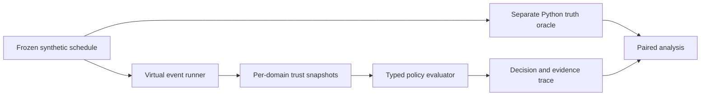

# ProofMesh

**Workload identity and trust-rotation research, with an offline policy engine you can inspect and run.**

ProofMesh studies a practical distributed-systems problem: a workload's credential can still look valid locally after its issuer has been revoked elsewhere. The engine checks identity, authorization and available trust evidence, then returns **ACCEPT**, **REJECT** or **INDETERMINATE** with a structured explanation.

This public companion contains the executable core, frozen synthetic scenarios, a separately implemented oracle, formal model sources and an optional real SPIFFE integration. It is a curated export of a larger research workspace, with [explicit source provenance](PUBLIC_EXPORT_MANIFEST.json).

[Quick start](#quick-start) · [Architecture](docs/ARCHITECTURE.md) · [Evidence and limitations](docs/EVIDENCE.md) · [Security](SECURITY.md) · [Portfolio](https://lefteriszach.com)

## Engineering highlights

- **Typed Go core:** exact trust-domain namespaces, immutable bundle snapshots, strict scenario parsing and a deterministic virtual event runner.
- **State across restarts:** retained sequence/epoch watermarks, tombstones, atomic checkpoints and controlled crash tests.
- **Reproducible experiments:** 81 frozen schedules across 27 families, paired baselines, an independent Python implementation of authoritative truth, and complete failure accounting.
- **Testable boundaries:** table/property tests, Go's race detector, fuzz entry points, and tests that reject incomplete formal-gate evidence.
- **Separate real cryptography:** the optional pinned `go-spiffe` module exercises maintained X.509/mTLS implementations. The simulator itself uses explicitly synthetic descriptors.

## Quick start

Requires **Go 1.27.2** and **Python 3.12+**. The Go core has no external modules; the Python core uses only the standard library.

```sh
make test
make demo
make restart-demo
make bench-offline
make report
```

If the pinned Go version is missing, `make setup` downloads it from the official Go service and verifies its checksum. After setup, the commands above work offline without API keys, containers or model services. Run them from the repository root.

```sh
./bin/proofmesh validate --scenario scenarios/dev/F04_s17.json
./bin/proofmesh simulate --scenario scenarios/dev/F06_s17.json --budget 120
./bin/proofmesh simulate --scenario scenarios/dev/F06_s17.json --budget 120 --strict
```

`--strict` maps uncertain evidence to REJECT; the default preserves INDETERMINATE. Neither mode can observe a remote revocation before evidence arrives. Generated experiment files remain local and are excluded from the public source inventory.

## How it works



The oracle knows the scenario's authoritative state; the verifier sees only delivered evidence. Keeping those views separate exposes the safety/availability cost of delayed trust updates.

## Findings worth inspecting

The original synthetic study preserves a negative result: **B2 and B3 have the same ACCEPT set at equal freshness budgets**. Explicit uncertainty improves the decision record; it does not establish stronger cryptographic security. At budget zero, the inspected study accepted no authorized requests, so “zero unsafe accepts” alone would be misleading.

The larger private study also exercised real trust rotation and retained mTLS sessions. This public export includes a [bounded evidence summary](docs/EVIDENCE.md), not its complete private raw archive. Its original real-system results are not represented as fresh results of this public CI.

## Verification and optional work

| Command | Scope |
|---|---|
| `make test` | Go core tests, Python oracle/reporting checks and formal-runner software controls |
| `make race` | Core Go race detector |
| `make check` | Core tests, vet, source-export hashes and public-text checks |
| `make fuzz` | Two bounded core fuzz exercises |
| `make integration-spiffe` | Opt-in real loopback mTLS tests; initially requires pinned module downloads |
| `make formal` | Opt-in installed Tamarin/Maude; missing tools or unresolved checks fail explicitly |

The default CI runs only the offline core. Formal-runner unit tests use a stub and **are not mathematical proof evidence**. The [formal guide](formal/README.md) and [integration guide](integration/spiffe/README.md) define prerequisites and scope.

## Research boundaries and attribution

This is experimental software, not a production security product. It makes no claim of new cryptography, universal correctness, independently established novelty or peer review. Hybrid key exchange is distinct from post-quantum certificate authentication; the simulator never marks a peer as PQ-authenticated.

The implementation was created with AI assistance. Repository ownership and Git attribution do not establish individual scientific authorship. [Contribution and attribution notes](CONTRIBUTING.md) preserve that distinction.

**Original-code reuse license: pending.** Source visibility is not an open-source license grant. Upstream libraries retain their own licenses and notices; see [rights and dependencies](LICENSE_PENDING.md) and [citation metadata](CITATION.cff).
